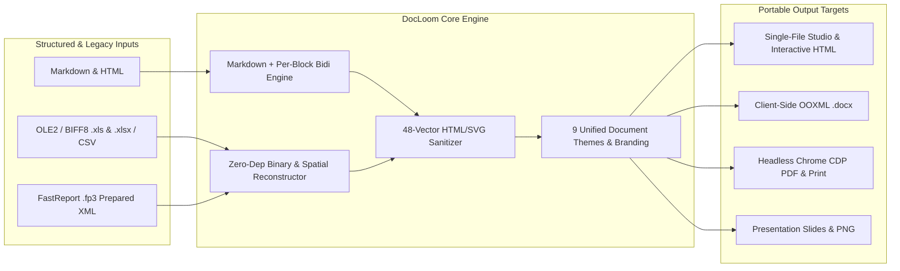

<div align="center">

  

  <h1>DocLoom</h1>

  <p>
    <strong>Offline-First Markdown &amp; Bidirectional (<code>EN</code> / <code>FA</code>, <code>LTR</code> / <code>RTL</code>) Document Studio,<br>
    Single-File HTML / PWA / DOCX / PDF Compiler &amp; Zero-Dependency Legacy Spreadsheet / FastReport Engine</strong>
  </p>

  <p>
    <a href="https://github.com/mojtabahasani/DocLoom/actions/workflows/ci.yml"></a>
    <a href="https://github.com/mojtabahasani/DocLoom/releases/tag/v1.4.0"></a>
    <a href="#run-tests--static-guards"></a>
    <a href="./build.mjs"></a>
    <a href="./LICENSE"></a>
  </p>

  <p>
    <a href="#why-docloom">Why DocLoom?</a> •
    <a href="#pipeline-architecture">Pipeline Architecture</a> •
    <a href="#format-matrix">Format Matrix</a> •
    <a href="#key-engineering-highlights">Highlights</a> •
    <a href="#quick-start">Quick Start</a> •
    <a href="#repository-structure">Structure</a>
  </p>

  <br>

  

</div>

---

DocLoom compiles a modular vanilla ES module and CSS workspace into a completely self-contained, zero-CDN single HTML artifact (under `900 KB` with inlined WOFF2 fonts) alongside an installable Progressive Web App (`dist/pwa/`) and an optional pure-Node companion server (`server/`).

---

## Why DocLoom?

Most browser-based document studios break down when dealing with three real-world engineering challenges:

1. **Bilingual & Bidirectional (`LTR`/`RTL`) Typography:** Switching smoothly between English (`LTR`) and Persian (`RTL`) workspaces—with automatic per-block direction detection across headings, lists, callouts, TOCs, and tables while preserving inline code runs and numeral scripts—often breaks in standard Markdown renderers.
2. **Legacy Binary & Coordinate-Based Reports:** Importing older binary `.xls` (OLE2 Compound File / BIFF8 records), messy SpreadsheetML exports, or FastReport `.fp3` prepared XML reports (which encode no explicit `<table>` structure—only raw `Left`/`Top`/`Width` memo coordinates) normally requires heavy server runtimes or proprietary desktop suites.
3. **Zero-Telemetry, Non-Destructive Local Workflows:** Sensitive financial, technical, and administrative documents require a deterministic, archive-first local studio that runs 100% offline from `file://` or `127.0.0.1` and **never silently destroys user history**.

DocLoom unifies all three into a compact, dependency-minimal codebase backed by **400 Node unit & integration tests**, **59 Playwright browser / WCAG 2.1 AA accessibility checks**, and **48 XSS sanitizer vectors**.

---

## Pipeline Architecture



---

## Format Matrix

| Direction | Format / Standard | Implementation Module(s) | Runtime Dependencies | Verified Coverage |
|---|---|---|---|---|
| **Input** | Markdown, GFM Tables, Callouts, Code, Mixed Bidi | `src/js/content/markdown.js`, `bidi.js` | Zero | `tests/markdown.test.mjs`, `bidi.test.mjs` |
| **Input** | Binary `.xls` (`OLE2/CFB`, `BIFF8`) | `src/js/bank/cfb.js`, `biff.js` | Zero (Pure JS) | `tests/xls.test.mjs`, `bank.test.mjs` |
| **Input** | `.xlsx`, SpreadsheetML `.xls`, International/Regional CSV | `src/js/bank/sheet-read.js`, `bank-table.js`, `normalize.js` | `fflate` (ZIP deflate) | `tests/bank.test.mjs` |
| **Input** | FastReport `.fp3` Coordinate XML | `src/js/saba/fp3.js`, `fp3-table.js`, `saba-report.js` | Zero (Pure JS) | `tests/saba.test.mjs` |
| **Output** | Offline Single HTML & Interactive Reader | `build.mjs`, `src/js/export/html.js`, `interactive-core.js` | `esbuild` (build-time) | `tests/export4.test.mjs`, `sw.test.mjs` |
| **Output** | OOXML `.docx` Word Package | `src/js/export/docx.js`, `docx-dom.js` | `fflate` (ZIP package) | `tests/export4.test.mjs` |
| **Output** | Print-Ready PDF (Headless Chrome CDP) | `server/lib/pdf.js`, `server/index.js` | Zero (Native CDP pipe) | `tests/server/*.test.mjs` |
| **Output** | Presentation Deck & PNG Snapshot | `src/js/export/present-core.js`, `png.js` | `modern-screenshot` | `tests/export4.test.mjs` |

---

## Key Engineering Highlights

### 1. Single-File Compiler, Live Bilingual UI (`EN`/`FA`) & Offline PWA
- **`build.mjs`** bundles `src/js/app.js`, ordered CSS layers (`src/styles/`), and base64-inlined WOFF2 fonts via `esbuild` into a single standalone HTML file (`< 900 KB` build-time size budget).
- **Live Bilingual Localization Engine (`src/js/core/i18n.js`, `src/js/ui/lang.js`)**: Defaults to English (`LTR`) with a one-click topbar `EN / FA` toggle and command palette shortcuts that dynamically localize panels, modals, AI prompts (`REPORT_PROMPT_EN`), layout direction, and digit formatting.
- **Automatic Per-Block Bidi Detection (`src/js/content/bidi.js`)**: Scans each heading, paragraph, list, callout, cover card, TOC, and table to apply `dir="ltr"` or `dir="rtl"` without mutating inline code spans.
- Generates `dist/pwa/` with custom weave icons (`pwa/icons/`) and a content-hashed Service Worker (`pwa/sw.js`) that safely bypasses dynamic `/api/*` and revocable `/s/*` routes.

### 2. Zero-Dependency Binary Spreadsheet & Spatial Table Parsers
- **Pure-JS OLE2/CFB & BIFF8 `.xls` Decoder (`src/js/bank/cfb.js`, `src/js/bank/biff.js`)**: Implements Compound File Binary sector/FAT/DIFAT/mini-stream traversal and BIFF8 record parsing (`RK` 4-mode number unpacking, `SST` `CONTINUE` string blocks, and rich-text/phonetic block skipping) from scratch with zero third-party Excel libraries.
- **International & Regional Multi-Format Ledger Pipeline (`src/js/bank/sheet-read.js`, `bank-table.js`, `normalize.js`, `kinds.js`)**: Supports `.xlsx` (via `fflate`), SpreadsheetML, CSV, international English ledger headers (`Transaction Date`, `Credit`, `Debit`, `Running Balance`, `Narrative`), ISO Gregorian (`YYYY-MM-DD`) and Jalali dates, heuristic header scoring across multi-row preambles, and reverse-chronological balance reordering.
- **FastReport `.fp3` Geometric Table Reconstructor (`src/js/saba/fp3.js`, `fp3-table.js`, `saba-report.js`)**: Reconstructs semantic tables and key-value metadata directly from absolute memo coordinates in prepared FastReport XML files.

### 3. Multi-Format Export & Headless Chrome CDP PDF Engine
- **Client-Side OOXML `.docx` Builder (`src/js/export/docx.js`, `docx-dom.js`)**: Assembles standards-compliant Word documents in the browser via `fflate` with bidirectional runs, tables, callouts, headings, and embedded assets.
- **Rich Export Targets (`src/js/export/`)**: Standalone searchable HTML (`interactive.js`), slide presentation mode (`present.js`), PNG snapshot (`png.js`), print stylesheets (`print.css`), and 9 unified document color themes (`src/js/export/theme.js`).
- **Zero-Dependency Companion Server (`server/`)**: Pure Node.js HTTP server (`server/index.js`) with headless Chrome over `--remote-debugging-pipe` CDP (`server/lib/pdf.js`) for single-document and batch PDF generation, realpath-confined file linking (`server/lib/files.js`), SSE live reload, PIN auth, and revocable share links (`/s/<id>`).

### 4. Non-Destructive Archive & Conflict-Safe Multi-Device Sync
- **Archive-Instead-of-Delete (`tests/no-destroy.test.mjs`)**: Document and brand removals set `archivedAt` while preserving all versions; server-side deletion writes gzipped snapshots into `library/_retired/` before writing tombstones. A static enforcement test prevents unapproved destructive database or filesystem calls.
- **Content-Aware Sync (`src/js/server/sync-core.js`)**: Avoids false-positive conflict duplicates when local `base` state is missing by resolving inherited brand assets (`docToPatch`) and comparing normalized content (`sameDocContent`).
- **Asset Deduplication (`src/js/library/doc-model.js`, `tools/dedupe-library.mjs`)**: Deduplicates ~5 MB per-revision base64 letterhead/signature payloads by referencing parent brand assets.

### 5. Security, Accessibility & Embeddable SDK
- **Strict HTML Sanitizer (`src/js/content/sanitize.js`)**: Verified against 48 XSS attack vectors (`tests/sanitize.test.mjs` and Playwright `tests/e2e/xss.spec.mjs`).
- **WCAG 2.1 A/AA Audited (`tests/e2e/a11y.spec.mjs`)**: Automated `@axe-core/playwright` audits across editor, command palette, modals, dark mode, and reading views.
- **Embed Mode (`src/js/core/embed-config.js`, `src/js/embed/embed.js`)**: Opt-in host integration configuration and `postMessage` API (`window.DOCLOOM_EMBED`).

---

## Quick Start

### Prerequisites
- **Node.js** `>= 20`
- **Chromium / Google Chrome** (optional, required only for Playwright E2E tests and server-side CDP PDF rendering)

### Install & Build
```bash
git clone https://github.com/mojtabahasani/DocLoom.git
cd DocLoom
npm install
npm run build
```

Build outputs:
- `DocLoom.html` / `dist/DocLoom.html` — standalone single-file studio (open directly in any browser)
- `dist/pwa/` — installable PWA bundle

### Run the Companion Server (Optional)
```bash
npm run server
```
Starts the pure-Node companion server on `http://127.0.0.1:7123`.

### Run Tests & Static Guards
```bash
# Run all 400 unit and server integration tests
npm test

# Run static code quality and guardrail checks
npm run guard:ratchet

# Run Playwright browser E2E & WCAG 2.1 accessibility tests
npm run test:e2e
```

---

## Repository Structure

```text
DocLoom/
├── build.mjs                 # Single-file HTML + PWA compiler (esbuild + inlined WOFF2)
├── docs/assets/              # Repository banner & app icons (docloom-banner.png, docloom-icon.png)
├── src/
│   ├── index.html            # Application shell, inline SVG favicon & icon-rail panel drawers
│   ├── styles/               # Layered CSS design tokens, layout, drawer, print & table styles
│   ├── fonts/                # Subset Vazirmatn WOFF2 fonts (OFL)
│   └── js/
│       ├── core/             # Versioning, i18n localization, storage compatibility, digits, XML, guard
│       ├── content/          # Markdown parser, bidi detector, typography normalization, SVG charts, TOC, sanitizer
│       ├── bank/             # Zero-dep OLE2/CFB, BIFF8 .xls, XLSX, CSV, tabular formatter
│       ├── saba/             # FastReport .fp3 XML geometric table reconstructor
│       ├── brand/            # Document mastheads, footers, QR blocks, watermarks, signatures
│       ├── export/           # Client-side DOCX, interactive HTML, slides, PNG, themes
│       ├── library/          # IndexedDB store, version history, backups, fuzzy search
│       ├── server/           # Conflict-safe sync client, linked files, PDF & batch client
│       ├── embed/            # Opt-in host page integration API
│       └── ui/               # Command palette (Cmd/Ctrl+K), switcher, rail drawer, modals, reading mode
├── server/                   # Zero-dep Node HTTP server, CDP PDF renderer, file API, CLI
├── pwa/                      # Service worker, icons & manifest templates
├── scripts/guardian/         # Static rule scanner & baseline ratchet
├── tools/                    # Ledger reconciliation verifier & library deduplication tool
└── tests/                    # 400 unit/server tests + Playwright E2E, XSS & axe-core suites
```

---

## License

Released under the [MIT License](./LICENSE).
